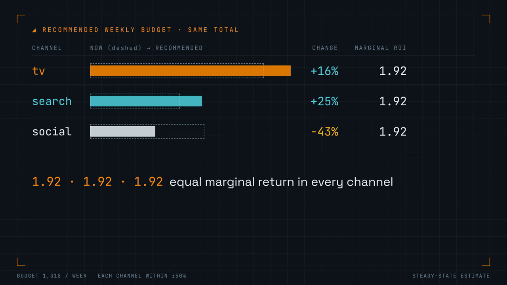

# MMM Budget Optimizer

Agent skill: marketing mix modelling from weekly sales and spend. Find where your next pound sells most.

▶ [Watch the demo (MP4, 71 s, narrated)](demo-video/final/mmm-budget-optimizer-demo.mp4)

## Install

- Any SKILL.md agent: `npx skills add yablokolabs/mmm-budget-optimizer`
- Claude Code, by hand: copy `skills/mmm-budget-optimizer/` to `.claude/skills/`
- Zip: [Releases](https://github.com/yablokolabs/mmm-budget-optimizer/releases) or [`dist/`](dist/mmm-budget-optimizer.zip)

## What it does

- Turns daily or long-format data into a weekly CSV, with data checks (gaps, constant or correlated channels, history length)
- Fits adstock, saturation, trend and seasonality with [mmm-engine](https://github.com/yablokolabs/mmm-engine) (C++, ~20 ms)
- Scores the model on the last 13 weeks it never saw; stops if accuracy is too low
- Reports each channel's share, total ROI and **marginal ROI**
- Moves budget until every channel has the same marginal return, each within ±50% of today
- Writes a Markdown report

## Needs

- Python 3.9+ (standard library only), curl
- Engine: `bash skills/mmm-budget-optimizer/scripts/install_engine.sh` installs a checksum-verified prebuilt binary (Linux x86-64/arm64, macOS Apple Silicon) in ~1 s; other systems build from source (git, CMake, GCC 13+) or use Docker
- No API keys; runs offline after install

## Result on the bundled example

| Channel | Marginal ROI now | Weekly spend | After |
| --- | --- | --- | --- |
| search | 2.33 | 313 → 391 (+25%) | 1.92 |
| tv | 2.21 | 606 → 700 (+16%) | 1.92 |
| social | 1.22 | 399 → 227 (−43%) | 1.92 |

- Same total budget; media-driven sales +95 per week (+2.5%)
- Holdout error: 0.6% MAPE on 13 unseen weeks

## Trust check (data with known answers)

| Measure | 10 synthetic datasets |
| --- | --- |
| Holdout MAPE | ≤ 0.9% |
| Marginal ROI vs truth | 11% average error, 41% worst |
| Plan quality on the **true** curves | ≥ 92% of best lift on 9 of 10; 63% on 1 |

## Repo layout

| Path | Contents |
| --- | --- |
| `skills/mmm-budget-optimizer/` | the skill: `SKILL.md`, scripts, references, examples |
| `dist/` | the skill as an upload-ready zip |
| `agensi/` | marketplace listing text, logo, screenshot |
| `demo-video/` | [Videowright](https://github.com/scosman/videowright) project; `data/build_data.py` generates every number |
| `tests/` | end-to-end skill test, zip check (run in CI) |
| `docs/how-it-was-built.md` | step-by-step build notes, reuse prompt |

## Limits

- Correlational: validate large moves with a lift test
- Total ROI of always-on channels is soft; use marginal ROI
- No confidence intervals, no lagged adstock peak, weekly data only

## License

MIT, Yabloko Labs. Third-party parts: [THIRD_PARTY_NOTICES.md](THIRD_PARTY_NOTICES.md).
